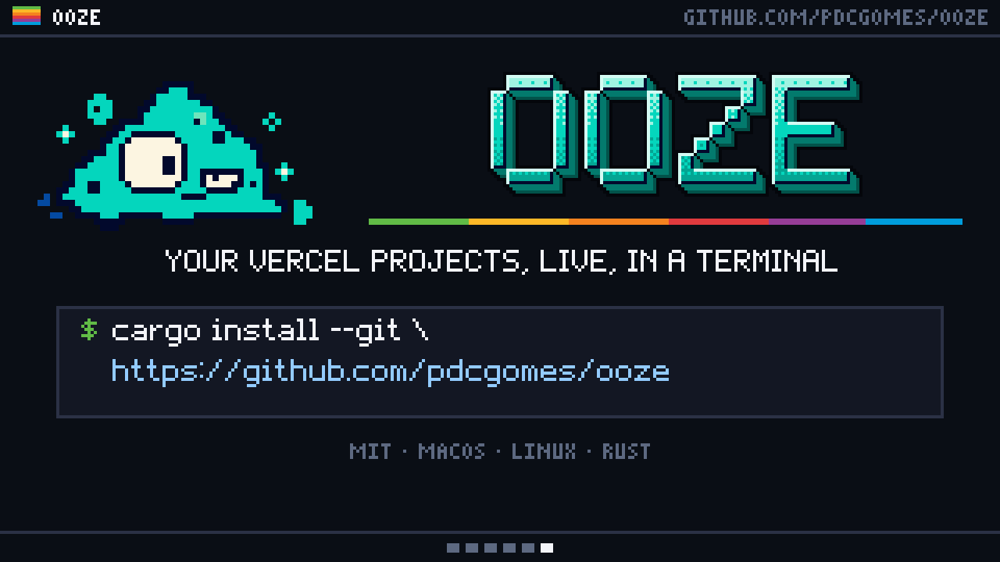

# ooze in 30 seconds

A video for posting [ooze](https://github.com/pdcgomes/ooze): 1280×720, 30 seconds, 392 KB. `ooze.gif` is the same at half the size, 293 KB, for ooze's README.

1. Who's on your sites: 40 online, page views a minute, the busiest projects.
2. Deploys as they happen: a build's clock and its log, then live; a failed one says why.
3. Spikes as they land: traffic at 4× its usual, and the notification it sends.
4. What it all costs: $26.40 of the $20 credit, and where it's heading.
5. Roll back, and it asks first.
6. The install command.

The Slime, badcoffee.dev's triangle-shaped creature, oozes each scene into the next. The numbers come from `ooze demo`, the made-up team in ooze's screenshots.

`banner.py` draws ooze's title for the top of its README: the Slime and the name, on nothing, so it sits on GitHub's light and dark pages alike.

